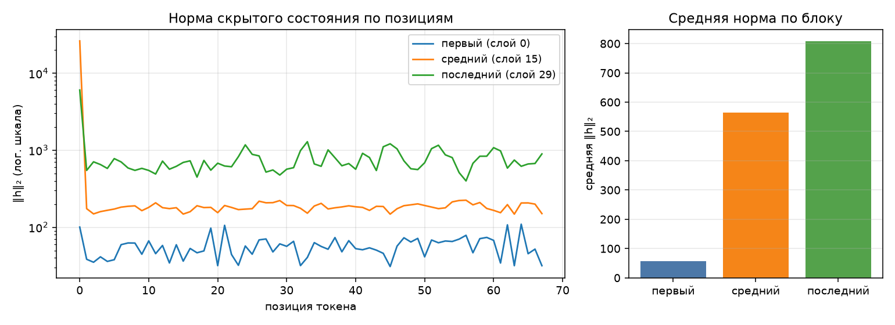

# Анатомия SmolLM2-135M-Instruct

Сгенерировано `make inspect`. dtype `bfloat16`, device `mps`.

## 1. Конфигурация

| Параметр | Значение |
|---|--:|
| слоёв | 30 |
| hidden_size | 576 |
| intermediate_size | 1536 |
| голов запроса | 9 |
| KV-голов (GQA) | 3 |
| head_dim | 64 |
| словарь | 49 152 |
| tie_word_embeddings | True |

GQA: 9 голов запроса на 3 KV-головы — KV-cache в 3 раза меньше, чем при обычном multi-head.

## 2. Условия замера

| Условие | Значение |
|---|---|
| платформа | macOS-26.6.2-arm64-arm-64bit (Darwin 25.6.0, arm64) |
| устройство | `mps` |
| dtype | `bfloat16` |
| seq_len × batch | 256 × 1 |
| прогонов на режим | 1 |
| память измерена | `torch.mps.driver_allocated_memory` |
| RSS измерена | `ru_maxrss` |
| python | 3.12.4 |
| torch | 2.14.0 |
| transformers | 5.16.1 |
| peft | 0.20.0 |

Цифры ниже верны только для этих условий. Замер памяти без указания
устройства, dtype, длины последовательности и метрики не воспроизводится
и не сравнивается — поэтому источник метрики стоит отдельной строкой.
Сверьте, что в этой строке названа метрика, уместная для вашего
устройства, и что полученные числа с ней согласуются.

## 3. Параметры по типам модулей

| Группа | Модулей | Shape | Параметров | Доля | Разделяет тензор |
|---|--:|---|--:|--:|--:|
| `embed` | 1 | 49152×576 | 28 311 552 | 21.05% | — |
| `q_proj` | 30 | 576×576 | 9 953 280 | 7.40% | — |
| `k_proj` | 30 | 192×576 | 3 317 760 | 2.47% | — |
| `v_proj` | 30 | 192×576 | 3 317 760 | 2.47% | — |
| `o_proj` | 30 | 576×576 | 9 953 280 | 7.40% | — |
| `gate_proj` | 30 | 1536×576 | 26 542 080 | 19.73% | — |
| `up_proj` | 30 | 1536×576 | 26 542 080 | 19.73% | — |
| `down_proj` | 30 | 576×1536 | 26 542 080 | 19.73% | — |
| `norm` | 61 | 576 | 35 136 | 0.03% | — |
| `lm_head` | 1 | 49152×576 | 0 | 0.00% | 28 311 552 |
| **итого** | | | **134 515 008** | 100% | |

Контроль: `sum(p.numel() for p in model.parameters())` = 134 515 008 — сходится с суммой по таблице.

Обратите внимание на строку `lm_head` и на значение `tie_word_embeddings`
в конфигурации: они связаны, и от этой связи зависит итог таблицы.

## 4. Нормы активаций (forward-hooks)

Промпт: «Объясни, что такое MLOps, в трёх предложениях.», 68 токенов после chat template.

| Блок | Индекс | Средняя ‖h‖₂ | Максимум |
|---|--:|--:|--:|
| первый | 0 | 56.8 | 109.5 |
| средний | 15 | 564.7 | 26134.7 |
| последний | 29 | 807.3 | 6026.1 |

Норма растёт от блока к блоку — прямое следствие residual-связей: блок
добавляет к потоку, а не заменяет его. Максимум на порядок-два выше среднего,
и сидит он на первой позиции: это attention sink, массивная активация,
в которую модель складывает «внимание ни к чему». Поэтому шкала на графике
логарифмическая — в линейной один этот выброс придавил бы всё остальное.

Прогон с хуками должен быть повторяемым: второй вызов в том же процессе
обязан дать те же числа и не оставить следов на модулях.

## 5. Сколько параметров добавляет LoRA

| Конфиг | Целевых модулей | Своя формула | peft | Совпало | % от базовой |
|---|--:|--:|--:|:-:|--:|
| r=8, q_proj+v_proj | 2 типов | 460 800 | 460 800 | да | 0.343% |
| r=16, все линейные | 7 типов | 4 884 480 | 4 884 480 | да | 3.631% |

Формула: `r * (in_features + out_features)` на каждый целевой `Linear` —
`A` формы `(r, in)`, `B` формы `(out, r)`, смещений нет. Расхождение с
`print_trainable_parameters()` означает ошибку в списке целевых модулей,
а не «разные способы считать».

Доля в таблице считается от базовой модели. `peft` печатает свою долю от
модели ВМЕСТЕ с адаптером, поэтому его процент чуть меньше — числитель
у обоих один и тот же.

## 6. Память в трёх режимах

Один шаг на seq_len=256, batch=1, device=mps. Метрика — аллокатор mps (`torch.mps.driver_allocated_memory`), пик за прогон; колонка «Пик RSS» снята через `ru_maxrss`.
Вход — случайные id токенов: меряется память, а не качество, и loss здесь
смысловой нагрузки не несёт (у full FT и LoRA он одинаковый, потому что
`B` в адаптере инициализирован нулями и до первого шага ничего не меняет).
Числа должны отличаться: по лекции full fine-tune стоит кратно дороже
инференса, а LoRA лежит между ними.

| Режим | Пик, МБ | Пик RSS, МБ | × к инференсу | Секунд | loss |
|---|--:|--:|--:|--:|--:|
| инференс | 1312 | 566 | 1.00 | 4.5 | — |
| full fine-tune | 1744 | 887 | 1.33 | 6.1 | 13.0492 |
| LoRA (r=8, q/v) | 1704 | 904 | 1.30 | 10.3 | 13.0492 |

Прикидка из лекции: веса bf16 — 257 МБ. Full fine-tune добавляет
градиенты (+257 МБ) и два состояния AdamW (+513 МБ),
то есть ×4 к весам ещё до активаций — что и видно в замере.
LoRA обучает 460 800 параметров вместо 134 515 008:
градиенты и состояния оптимизатора считаются только для адаптера, базовые
веса заморожены. Остаётся расход на активации — поэтому LoRA всё же дороже
инференса, хоть и втрое дешевле полного дообучения.

Колонка «Пик RSS» между режимами почти не меняется: разброс 338 МБ на все три — и это при том, что full fine-tune обязан добавить к весам ещё 770 МБ.
Объясните этот разброс: что именно меряет `ru_maxrss` на устройстве `mps` и где на самом деле лежат тензоры.

## 7. Найденные дефекты

### Дефект 1 — forward-hooks не снимались

В чём был: `forward_hooks()` в `src/inspect_model.py` регистрировал
`module.register_forward_hook(...)`, но не сохранял возвращаемый
`RemovableHandle` и никогда не вызывал `handle.remove()`.

Как проявлялся: повторный вызов `activation_norms()` в одном процессе
копил обработчики на одних и тех же модулях модели — каждый следующий
прогон запускал уже N+1 хуков вместо одного на слой, расход памяти рос,
а сама модель не возвращалась к состоянию до вызова.

Как исправлен: `forward_hooks()` теперь возвращает список хендлов вместе
со словарём, а `activation_norms()` снимает все хендлы в `finally` сразу
после прямого прохода.

Числом подтверждается: `tests/check_anatomy.sh`, пункт 3 — после двух
подряд вызовов `activation_norms()` на модулях модели зарегистрировано
0 хуков.

### Дефект 2 — tied embeddings считались дважды

В чём был: `parameter_rows()` собирает параметры через
`model.named_parameters(remove_duplicate=False)` (иначе `lm_head` не
попадёт в таблицу), но каждая строка была жёстко помечена `"tied": False`.

Как проявлялся: при `tie_word_embeddings=True` тензор `embed_tokens.weight`
и `lm_head.weight` — один и тот же объект, отданный `named_parameters`
дважды. Обе строки суммировались как уникальные параметры, раздувая
итог таблицы примерно на пятую часть (лишние 28 311 552 к 134 515 008 дают 162 826 560, +21%).

Как исправлен: строки таблицы отслеживают уже встреченные тензоры по
`id(param)`; повторное появление того же тензора помечается `tied=True`
и уходит в `tied_params`, а не в общую сумму `params`.

Числом подтверждается: `params_total` (сумма по таблице) =
`params_direct` (`sum(p.numel() for p in model.parameters())`) =
134 515 008, расхождение — 0.

### Дефект 3 — три режима памяти мерялись в одном процессе

В чём был: `memory_profile()` вызывал `measure_mode()` для всех трёх
режимов (`inference`, `full_ft`, `lora`) напрямую, в одном и том же
процессе.

Как проявлялся: счётчики пика памяти (RSS high-water mark, а на
ускорителе — счётчики аллокатора) не сбрасываются сами по себе внутри
процесса. Более лёгкий режим, измеренный после тяжёлого, наследовал его
исторический пик — три режима выглядели почти одинаковыми вместо
ожидаемого `full_ft > lora > inference`.

Как исправлен: `memory_profile()` теперь запускает каждый режим как
отдельный процесс через уже существовавший, но не использовавшийся
служебный режим `python -m src.inspect_model --probe <mode>` —
`measure_mode_subprocess()`.

Числом подтверждается: пик режима `full_ft` = 1744.1 МБ >
пик `lora` = 1704.1 МБ > пик `inference` = 1312.1 МБ
(числа — из `docs/report.json`, раздел `memory`).

### Дефект 4 (и TODO) — память ускорителя измерялась как RSS процесса

В чём был: `device_allocated_bytes()`/`device_metric_source()`
игнорировали переданный `device` и всегда вызывали `peak_rss()` (host
RSS), даже когда `PeakMemory.result()` подписывал число как «аллокатор
mps»/«аллокатор cuda». Соседний `TODO` в `PeakMemory.__exit__` указывал
на вторую часть той же проблемы: `gc.collect()` выполнялся до снятия
показания.

Как проявлялся: на ускорителе тензоры лежат в его памяти, а не в host
RSS процесса — измеренное число почти не реагировало на размер модели
и колебалось между запусками, при этом подпись метрики врала (называла
её «аллокатором», хотя по факту это была RSS).

Как исправлен: `device_allocated_bytes`/`device_metric_source` теперь
ветвятся по `device.type` — `torch.cuda.max_memory_allocated()` для
cuda, `torch.mps.driver_allocated_memory()` для mps, RSS остаётся только
как fallback для cpu. Порядок в `PeakMemory.__exit__` изменён: показание
снимается до `gc.collect()`, а не после — иначе сборка мусора успевала
освободить то, что должно было засчитаться расходом режима.

Числом подтверждается: метрика в отчёте — `torch.mps.driver_allocated_memory`
(не `ru_maxrss`/`peak_wset`), `tests/check_anatomy.sh`
пункт 6 — зелёный.

### Числа на SmolLM2-135M-Instruct: параметры, LoRA, память

Модель — `HuggingFaceTB/SmolLM2-135M-Instruct`: 30 слоёв, hidden 576,
intermediate 1536, 9 голов запроса и 3 KV-головы, словарь 49 152, tied
embeddings. Все числа ниже — из `docs/report.json`, условия замера — раздел 2.

**Параметры.** Всего 134 515 008 (по таблице и по `sum(p.numel())`
совпало). Эмбеддинг (28 311 552, 21.05%) общий с `lm_head`, поэтому в
таблице у `lm_head` ноль. MLP (три матрицы по 26 542 080) — 59.2% модели,
внимание (q/k/v/o) — 19.7%: `k_proj` и `v_proj` втрое меньше `q_proj` из-за
GQA (192 против 576 выходных признаков), KV-cache в 3 раза меньше, чем при
multi-head. Нормировок (RMSNorm) 61 штука, 35 136 параметров (0.03%); у
SmolLM2, в отличие от Qwen3, нет `q_norm`/`k_norm` внутри внимания.

**LoRA.** `r=8` на `q_proj`+`v_proj` — 460 800 параметров (0.343% от базы),
`r=16` на все семь линейных — 4 884 480 (3.631%). Формула `r * (in + out)` на
каждый целевой `Linear` совпала с `peft` в обоих случаях. В обучении ДЗ 5
(`r=8`, все семь линейных) обучается 2 442 240 параметров: это тот же расчёт на
другом наборе модулей.

**Память в трёх режимах** (seq_len 256, batch 1, `mps`, bf16): инференс
1312.1 МБ, full fine-tune 1744.1 МБ (x1.33), LoRA 1704.1 МБ (x1.30). Порядок
`full_ft > lora > inference` верный, но разрыв между full fine-tune и LoRA
всего 40 МБ (2.3%), а не «втрое дешевле», как сказано в сгенерированном
тексте раздела 6. Над инференсом full fine-tune добавляет 432 МБ, а оценка
по лекции (градиенты + два состояния AdamW) даёт +770 МБ при весах 257 МБ.
Расхождение с оценкой я не исследовал: метрика — пик аллокатора `mps`
(`torch.mps.driver_allocated_memory`), активации и логиты по словарю 49 152
отдельно не измерялись. Пик больше весов (257 МБ) во всех трёх режимах.
Время шага: 4.5 с, 6.1 с, 10.3 с — LoRA медленнее полного дообучения, и
почему, тоже не выяснялось (один замер, `repeats` = 1).
